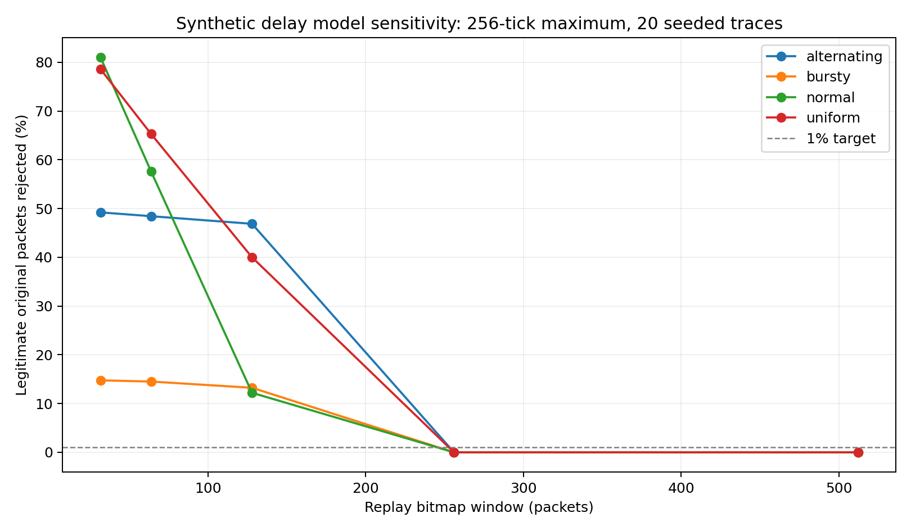

# Experimental capstone findings — candidate v0.3.0

## Abstract

This study evaluates packet acceptance tradeoffs for a replay window in a
custom, **unaudited** single-peer educational UDP tunnel. A set-based oracle
and the implemented 128-packet sliding bitmap were compared under simulated
in-order issuance plus four bounded delay profiles. Two negative-test
approaches were also added: deterministic exhaustive single-position bit
mutations of authenticated frames and a bounded LLVM coverage-guided fuzz run.

**The central finding is a workload dependence:** the previous 128-packet
selection avoids false late-original rejection for a uniform 128-tick bound,
but not for 256-tick maximum delay. Under the 256-tick synthetic profiles,
256 packets is the smallest evaluated width satisfying a worst-seed false-drop
target of 1%. This is a model-specific observation, not a universal
recommendation or evidence of network throughput.

## Experimental setup

- Implementation: C++17, OpenSSL AES-256-GCM, independent HKDF-derived traffic keys.
- Replay method: independently implemented set-based acceptance oracle; check
  production 128-position bitmap agrees on every injected arrival at that width.
- Traces: 2,048 unique packet IDs per seed; 20 seeds per configuration.
- Delay profiles: uniform, truncated normal, low-delay bursts with 15% heavy
  tail, and alternating delay (worst-pattern). Bounds 32, 64, 128, 256 ticks.
- Candidate replay-window sizes: 32, 64, 128, 256, 512 packets.
- Inject every original twice consecutively (duplicate); re-submit old IDs
  after the trace to validate their rejection.
- Independent runs: 4 profiles × 4 max delays × 20 seeds × 5 widths =
  **1,600 simulations**, or 3,276,800 original arrivals (not including attacks).
- Confidence bounds: percentile bootstrap (2,000 resamples of 20 seeds)
  estimating uncertainty of the mean false-rejection rate, **not** the
  underlying Internet traffic population.

## Findings: maximum synthetic delay 256 ticks

| Delay profile | 64-window rejected originals | 128-window rejected originals | 256-window rejected originals |
|---|---:|---:|---:|
| Uniform | 65.32% | 40.01% | 0.00% |
| Truncated normal | 57.64% | 12.21% | 0.00% |
| Bursty | 14.52% | 13.24% | 0.00% |
| Alternating | 48.44% | 46.88% | 0.00% |

All numbers are **means over 20 simulation seeds**, except the deterministic
alternating model, whose seed has no effect. For full bootstrap intervals,
all five window sizes, and the other delay ceilings, see
[`evaluation/replay-robustness-summary.csv`](../evaluation/replay-robustness-summary.csv).
No duplicate or end-of-trace replay was accepted in the oracle campaign.

### Memory and research recommendation

| Width | Replay bitmap bytes | Bitmap + highest counter (logical bytes) |
|---:|---:|---:|
| 32 | 4 | 12 |
| 64 | 8 | 16 |
| 128 | 16 | 24 |
| 256 | 32 | 40 |
| 512 | 64 | 72 |

On the measured synthetic 256-tick traces, a 256-position bitmap provides the
minimum evaluated size that satisfies the <=1% worst-seed drop criterion.
Its 40 bytes of **logical replay state** is 16 bytes more than the current
128-window model. Object overhead, alignment and allocator cost are not
included. **The production tunnel remains fixed at 128**; changing it
requires separate malicious-input testing and live networking evaluation.

A larger window does not make a cryptographic replay attack successful by
itself if duplicate tracking is correct, but it changes the maximum accepted
reordering depth and can increase resources. It must not be chosen by simply
trusting unauthenticated traffic to request wider windows.

## Real namespace benchmark: previous v0.2.0 baseline ONLY

The following results were run by the repository operator on Ubuntu WSL2,
Linux `6.18.58.1-microsoft-standard-WSL2`, Intel Core Ultra 7 355,
OpenSSL 3.0.13, iperf3 3.16 (three repetitions per condition).

| Condition | Path | Median TCP Mbps | Median RTT ms | Median UDP loss % |
|---|---|---:|---:|---:|
| Clean | Direct | 64261.680 | 0.063 | 0.000 |
| Clean | Custom | 1690.508 | 0.652 | 0.000 |
| Clean | WireGuard | 1677.870 | 0.732 | 0.000 |
| Impaired | Direct | 5.345 | 40.755 | 0.927 |
| Impaired | Custom | 3.654 | 40.783 | 0.988 |
| Impaired | WireGuard | 3.651 | 41.313 | 1.047 |

The impairment profile was symmetric `tc netem delay 20ms 5ms loss 1% reorder
10% 50%`. This model is a local virtual namespace test, not WAN performance.
Only three runs were collected; reported differences do **not** establish
superiority to WireGuard. UDP send rate was limited to 20 Mbps and reordering
counters were not obtained. Raw user-local observations were not copied into
this patch; the published median source remains `docs/benchmark-medians-2026-11-20.csv`.
A **post-upgrade** benchmark and repeated cold-start trial are still needed.

## Security evaluation

- Existing authenticated handshake and packet tests continue to pass locally.
- Additional seeded campaign varies authenticated payloads, checks each
  ciphertext frame position with a single-bit mutation, attempts truncations,
  checks replay rejection, and ensures rejected packets do not poison the
  replay window or return plaintext.
- Bounded `libFuzzer -runs=2000` with ASan/UBSan completed in the local
  container without a reported crash. **2,000 fuzz cases are insufficient to
  claim vulnerability freedom.**
- Initial candidate tests: **6/6 CTest passed** with GCC and **6/6 with
  Clang+ASan+UBSan**. CI on the remote branch has not yet been checked.

## Threats to validity

1. **Model bias:** four synthetic profiles are not drawn from measured network
   packet-arrival traces; the 256 packet boundary is a function of this setup.
2. **Fuzzing coverage:** the harness exercises encrypted-data packet parsing,
   not all network syscalls, handshake state transitions or concurrency.
3. **Runtime portability:** sanitizer results from a local container may differ
   on WSL2 or GitHub-hosted runners. No privileged live test of the new gate.
4. **Statistical uncertainty:** bootstrap confidence bounds describe sampled
   pseudorandom seeds only, not independent real-world connections.
5. **Security claims:** accepted-late behavior, AEAD tag verification and
   selected negative tests are not formal cryptographic verification.

## Reproduction

See [`docs/CAPSTONE_UPGRADE.md`](CAPSTONE_UPGRADE.md) for the exact CMake,
CTest, sanitizer, fuzz, and research-reproduction commands.
